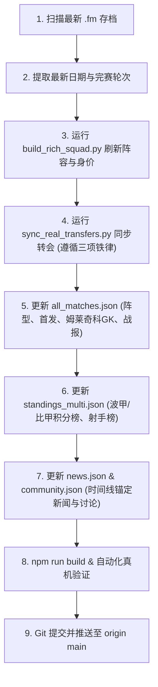

# 懂球云 (FM26 Companion Hub) 数据更新工作流规范

> **适用场景**：用户在 Football Manager 中推进了游戏进度并保存存档后，AI 每次读取本文件作为唯一执行 SOP（标准作业程序），以确保各维度数据准确无误、杜绝“穿帮”与“位置乌龙”。

---

## 目录
1. [核心原则与防穿帮铁律](#1-核心原则与防穿帮铁律)
2. [存档识别与时间线锚定](#2-存档识别与时间线锚定)
3. [六大数据文件更新清单](#3-六大数据文件更新清单)
4. [转会与财务三项铁律](#4-转会与财务三项铁律)
5. [标准更新执行步骤 (Step-by-Step)](#5-标准更新执行步骤)
6. [构建、验证与提交发布规范](#6-构建验证与提交发布规范)

---

## 1. 核心原则与防穿帮铁律

| 维度 | 规范要求 | 典型穿帮警告（严禁触犯） |
| :--- | :--- | :--- |
| **视角定位** | 严格维持大众体育 App（如懂球帝）球迷视角：“我关注的球队”、“主队动态”。 | **严禁**出现“我执教过的球队”、“流浪足迹”等打破第四面墙的字眼。 |
| **时间锚定** | 必须严格以当前最新比赛日期为基准（`match_date ± 3天`）。 | **严禁** 7-8 月夏窗期间生成 5 月底的欧冠决赛！7-8月背景新闻只能为夏窗 Here We Go、季前热身、联赛前瞻。 |
| **阵型还原** | 从 FM 存档真实提取战术设置（当前奥波莱为 **4-1-1-4 双前锋/双翼齐飞** 阵型）。 | **严禁** 凭空脑补 4-2-3-1 等默认阵型。 |
| **球员位置** | 从 `player_match_stats` 提取真实出场位置与评分。主力门将为 **米沃什·姆莱奇科 (GK #1)**，铃木淳也为 **右边后卫 (DR/WBR #2)**。 | **严禁** 将边后卫错填到 GK 位，战报中绝对不能出现“门将铃木淳也神扑”等荒谬描述。 |
| **评论多元** | 社区与比赛评论必须生成差异化的球迷昵称、IP 属地与语气观点。 | **严禁** 全站评论都是单一的“Galen”或千篇一律的机械化文案。 |

---

## 2. 存档识别与时间线锚定

### 2.1 存档路径
- **默认存档目录**：`C:\Users\Administrator\Documents\Sports Interactive\Football Manager 2024\games\`
- **筛选逻辑**：按最后修改时间（`mtime`）倒序排序，自动选取最新的一份 `.fm` 存档。
- **当前核心主队**：
  - **奥波莱奥德拉 (Odra Opole)**：`club_uid = 129566`（当前执教主队，主教练：`耶稣·徐`，中国 🇨🇳）
  - **维尔通精英 (R.E. Virton)**：`club_uid = 292`（前任执教主队，现任主帅：`范德海根`，比利时 🇧🇪）

### 2.2 确定当前轮次与最新比赛日
从存档提取当前球队最新的完赛记录：
- 获取比赛日期（如 `2026-08-01`）；
- 获取轮次序号（如波甲第 3 轮）；
- 背景比赛库与动态必须严格限定在该日期同一周内。

---

## 3. 六大数据文件更新清单

每次数据推进时，需要核实并更新以下 6 个核心数据文件（位于 `web/src/data/`）：

### ① `all_matches.json`（比赛详情与全量赛程）
- **新增最新完赛**：
  - 比分、进球者（含点球、头球标明）、助攻者、xG；
  - 真实出场名单（首发 11 人 + 替补出场），包含球员 uid、号码、实际打的位置、出场分钟、赛后评分、关键比赛数据（抢断、传球、解围、扑救）；
  - 战术阵型与跑位图（与游戏内实测阵型对齐）；
  - 沉浸式战报新闻：【比赛焦点】、【关键事件】与【战术复盘】，战报内提及的人名与位置必须与出场阵容 100% 对应；
  - 多元化球迷热评（3~5 条不同立场热评）。

### ② `standings_multi.json`（多联赛多赛季积分榜与数据榜）
- **置顶联赛刷新**：
  - 主队所在的 **波兰甲级联赛 (波甲 `pol_d1`)**：更新最新一轮全部队伍场次、胜平负、进失球、净胜球、积分；
  - 老东家所在的 **比利时职业联赛/挑战者联赛 (比甲 `bel_pro`)**；
- **个人数据榜**：
  - 射手榜、助攻榜根据最新轮次累加；
- **联赛转会动态**：
  - 与 `transfers.json` 保持严格同步。

### ③ `followed_clubs.json`（我关注的俱乐部专页）
- **俱乐部概览名片**：
  - 最新积分榜排名与升级/保级区状态（如 `第 2 名 (直接升级区)`）；
  - 战绩积分走势（如 `2胜 1平 0负 (7分)`）；
  - 近 5 场走势颜色块（`W/D/L`）；
  - 现任主帅名称（外文长名精炼，保留中文）；
  - 阵容总身价：按 `CURRENCY_MULTIPLIER` 计算的全队球员身价总和。
- **四大子 Tab**：
  - `动态`：更新最新联赛战报条目与伤病/转会公告；
  - `比赛`：同步本赛季最新已完赛卡片与未来 3 场赛程；
  - `阵容`：全队 26+ 名球员最新出场数、进球数、评分、身价、合同到期年份及 FM 雷达属性（注意国籍矢量图标：日本为 `circle-flags:jp`）；
  - `转会`：同步 `transfers.json` 最新转入与转出明细。

### ④ `transfers.json`（转会配置与截图人工覆写中心）
- 详见下一章【转会与财务三项铁律】。

### ⑤ `news.json`（资讯主页头条与新闻资讯流）
- 首页焦点战报（置顶主队最新比赛胜利或战报）；
- 顶部比分滚轴（展示主队与同期真实五大联赛/欧战比赛，严禁时间错乱）；
- 热点转会追踪与球队深度前瞻。

### ⑥ `community.json`（球迷社区热榜与帖子）
- 围绕最新比赛结果、绝杀球员（如普日比乌科连场绝杀）、争议判罚生成 2~3 篇高热度社区讨论帖；
- 发帖人与回帖人使用不同球迷昵称，模拟真实的懂球帝球迷社区生态。

---

## 4. 转会与财务三项铁律

所有涉及转会费、身价与周薪的逻辑，必须遵守 `scripts/transfer_config.py` 中的规范：

### 铁律 1：统一货币汇率换算 (`CURRENCY_MULTIPLIER`)
```python
CURRENCY_MULTIPLIER = 1.0  # 预留换算系数：将 fmsave 底层原始货币单位换算为游戏显示货币
```
- 所有从 `fmsave` 读出的 `transfer_value`、`contract.wage`、财政预算，统一乘以 `CURRENCY_MULTIPLIER` 再格式化输出为 `€XX万` 或 `€X,XXX/周`。

### 铁律 2：严禁将市场估值冒充实际成交转会费
在处理转会记录时，必须根据来源类型准确赋值：
1. **免签球员**（原 `club_uid == 0` 或自由身加盟）：金额必须标注为 **`免签`**（前端翠绿显示 `text-emerald-400 font-bold`）；
2. **租借球员**（租借加盟或离队）：金额必须标注为 **`租借`**（前端天蓝显示 `text-sky-400 font-bold`）；
3. **普通付费转会但无截图成交价**：金额必须格式化为 **`估值 €XX万`**（前端琥珀色显示 `text-amber-400 font-medium`），明确告知球迷此为参考身价，绝不编造虚假成交价。

### 铁律 3：支持手动/截图覆写优先 (`manual_overrides`)
- 在 `web/src/data/transfers.json` 中配置有 `manual_overrides` 结构；
- 一旦用户通过游戏【转会历史截图】获得某球员确切转会费（例如在配置中将铃木淳也的 `"fee"` 设为 `"€15万"`），脚本同步时以 override 为最高优先级，**绝对不可用估值覆盖已确认的真实成交价**！

---

## 5. 标准更新执行步骤

当用户要求更新数据时，按以下次序逐步执行：



### 具体命令集：
```powershell
# 1. 确保在项目根目录
cd "I:\fm26-virton-hub"

# 2. 运行阵容与属性同步脚本
.\venv\Scripts\python.exe scripts/build_rich_squad.py

# 3. 运行转会与估值同步脚本
.\venv\Scripts\python.exe scripts/sync_real_transfers.py

# 4. 编译前端确保无语法与模板报错
cd "I:\fm26-virton-hub\web"
npm run build
```

---

## 6. 构建、验证与提交发布规范

1. **编译检查**：在 `web` 目录下执行 `npm run build`，确保 0 报错、资源打包正常；
2. **移动端视口自适应复核**：
   - 关注页面 4 个概览卡片文字是否溢出（教练名字长名已精简）；
   - 转会列表文字（球员原俱乐部与转会费）单行截断省略号正常；
   - 积分榜顶部 3 个子切换按钮在 390px 视口下横向均分无挤压；
   - 比赛详情返回按钮能正确返回上一级 Tab，比赛筛选条件（全部焦点/最近完赛）未丢失；
3. **Git 提交并推送**：
   ```powershell
   cd "I:\fm26-virton-hub"
   git add .
   git commit -m "feat/fix: update FM season data to round X (YYYY-MM-DD)"
   git push origin main
   ```
4. **向用户汇报**：
   - 简洁明了总结本轮更新的核心内容（比赛赛果、积分榜排位变动、核心球员出场与转会动态）；
   - 提供修改的核心文件链接（使用 `file:///` 格式）。
